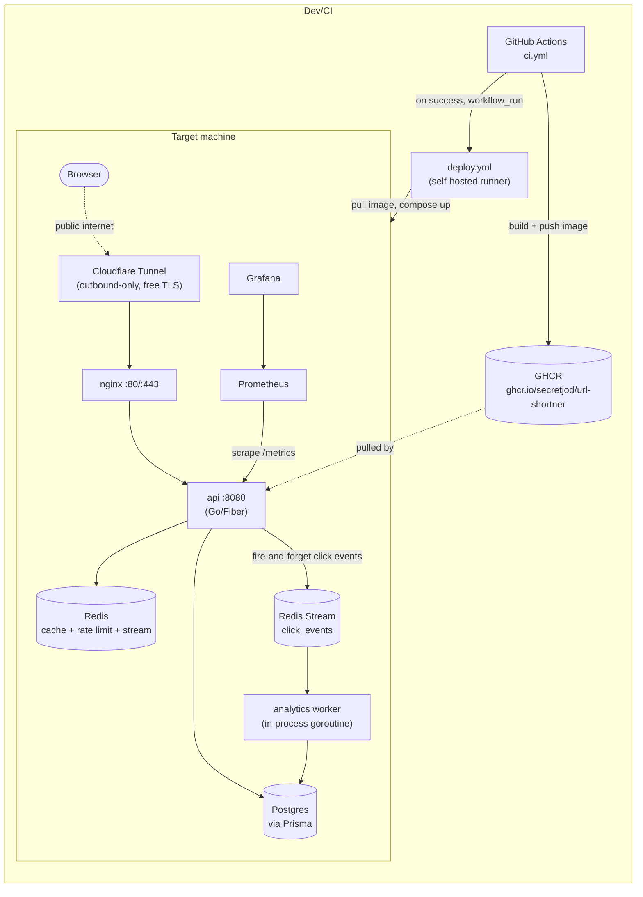

# Part 1 — Setup & Architecture

## 1. The 30,000-foot map

At its core this is a URL shortener: you give it a long URL, it hands you back a short one (`http://localhost/abc123`), and when someone visits that short link it redirects them to the original — while quietly recording that the click happened so the owner can see analytics later. Layered on top of that simple idea is everything a real production service needs: accounts (via email magic links, no passwords), API keys with rate-limit tiers, a Postgres database for durable storage, a Redis layer doing double duty as a cache and a click-event queue, a background worker draining that queue, and a full observability stack (Prometheus + Grafana) watching it all. The whole thing is one Go binary (`backend/cmd/api/main.go`) sitting behind nginx, with a React frontend built once and served as static files by that same binary — see `README.md:1-31` for the author's own one-paragraph description and diagram, which the system below mirrors with the deploy side added.



One thing worth internalizing early: the "analytics worker" in that diagram isn't a separate container or service — it's a goroutine started inside the same `main.go` process as the API server (see the CODEBASE GUIDE's "single binary ... that serves the API, the built SPA, *and* runs the analytics worker goroutine in-process"). That decision shapes a lot of what follows.

> ★ interview tip
> **Q:** Why does a click on a short link not write directly to Postgres?
> **A:** The redirect path only touches Redis (cache read + a fire-and-forget push onto a Redis Stream) so the user gets redirected as fast as possible; the actual database write happens asynchronously in the analytics worker, decoupling "serve the redirect" from "record the analytics."

## 2. Tech stack

Pulled straight from `backend/go.mod` and `frontend/package.json`, with "why" sourced from the repo's own comments wherever they exist (CODEBASE GUIDE, Dockerfile, config.go, docker-compose files).

| Layer | Dependency | Why (from the repo itself) |
|---|---|---|
| Backend lang/runtime | Go 1.25 (`backend/go.mod:3`) | Single static binary, cheap concurrency for the worker goroutine. |
| HTTP framework | `github.com/gofiber/fiber/v2 v2.52.14` | Used for the whole API — routing, middleware chain, static file serving (`main.go`). |
| ORM / DB client | `github.com/steebchen/prisma-client-go v0.47.0` | Generates a typed Go client from `backend/prisma/schema.prisma`; CODEBASE GUIDE: "`internal/db/prisma_store.go` — the only implementation." |
| Cache/queue client | `github.com/redis/go-redis/v9 v9.6.1` | Backs four distinct concerns in `internal/redis/` — cache, counter, rate limit, stream (CODEBASE GUIDE). |
| Metrics | `github.com/prometheus/client_golang v1.24.1` | Exposes `/metrics` for Prometheus scraping (`main.go:79`). |
| Env loading | `github.com/joho/godotenv v1.5.1` | Loads `.env` for local/non-Docker runs. |
| Decimal math | `github.com/shopspring/decimal v1.4.0` | Available for precise numeric handling (stats aggregation). |
| `go.mod` `replace` directives (`golang.org/x/sys`, `x/net`, `x/text`, `x/crypto` → `github.com/golang/...` mirrors) | — | CI's own comment (`ci.yml:36-39`) flags this as non-standard and a suspect in early CI flakiness — more in Chapter 7. |
| Frontend framework | React 18.2 + react-router-dom 6.22 (`frontend/package.json`) | SPA with client-side routing; CODEBASE GUIDE: "plain JS (no TypeScript)." |
| Build tool | Vite 5.1 | Dev server on `:5173` proxying `/api`, `/health`, `/metrics` to `:8080` (CODEBASE GUIDE); `npm run build` produces `frontend/dist`, which the Go binary serves directly — not its own container. |
| Styling | Tailwind CSS 3.4 + `tailwind-merge`, `clsx` | Utility CSS plus helpers for conditional class merging. |
| HTTP client | `axios ^1.6.7` | CODEBASE GUIDE: "`src/api/client.js` is the single axios instance (auth header + error normalization)." |
| Charts | `recharts ^2.12.2` | Renders the stats/analytics dashboards. |
| Animation | `framer-motion ^13.0.0` | UI transitions. |
| Icons | `lucide-react ^0.344.0` | Icon set for the UI. |
| Reverse proxy | nginx (`nginx:alpine`, `docker-compose.yml:97`) | Single public entrypoint; security headers, gzip (README.md:29-30). |
| Database | Postgres 16 (`postgres:16-alpine`) | Primary datastore, Prisma-managed schema. |
| Cache/queue | Redis 7 (`redis:7-alpine`) | Password-protected (`--requirepass`), used for cache + rate limiting + the click-event stream. |
| Mail sink (dev) | MailHog | SMTP catcher for magic-link/verification email in local dev, see Chapter 4. |
| Metrics stack | Prometheus + Grafana | Scrapes `/metrics` every 15s; dashboards provisioned automatically (README.md:93-99). |

> ★ interview tip
> **Q:** Why does the Go backend serve the frontend's built files instead of running a separate frontend container?
> **A:** CODEBASE GUIDE is explicit: "Built output is served by the Go binary, not by a separate container" — one binary, one container, one thing to deploy and health-check; the Dockerfile's frontend-builder stage exists only to produce static files that get copied into the final image (Chapter 4).

## 3. Repo layout

Verified against the actual tree (`ls -la` from repo root), not memory:

- `backend/` — the Go service: `cmd/api` (entrypoint, `main.go`), `internal/{auth,config,db,handlers,mail,metrics,middleware,redis,shortcode,store,worker}`, `prisma/` (schema.prisma, the source of truth for the DB shape).
- `frontend/` — React/Vite app: `src/{api,components,context,hooks,pages,utils}`, `public/`, `dist/` (build output — this is what gets copied into the Docker image), `node_modules/` (local install, not shipped).
- `docs/system-design/` — `01` through `11` numbered design docs plus `adr/` (architecture decision records) — CODEBASE GUIDE calls these out explicitly as recording *current and proposed* state, with ADRs for analytics decoupling, the authorization model, nginx, and CI/CD.
- `.github/workflows/` — `ci.yml` (test + build + push to GHCR) and `deploy.yml` (self-hosted-runner deploy, triggered by `workflow_run` off CI).
- `.devcontainer/` — GitHub Codespaces config (Docker-in-Docker, auto-bring-up for demos — README.md:60-83).
- `nginx/` — `nginx.conf`, the reverse-proxy config referenced by both compose files.
- `monitoring/` — `prometheus/alerts.yml` and `grafana/provisioning/...` (dashboards + datasource, auto-provisioned).
- `load-tests/` — k6 load test scripts and results (the subject of the most recent commit on this branch, `c6944f7`).
- `scripts/` — demo/seed data tooling (`seed-demo-data.sql`), explicitly *not* a production seeding tool (README.md:101-108).
- `notes/` — this file.
- Root-level docs: `README.md`, `GETTING_STARTED.md`, `DEPLOY.md`, `CASE_STUDY.md`, `SYSTEM_DESIGN_TOPICS.md`, `CLAUDE.md`, `interview.md`.
- Root-level infra: `docker-compose.yml` (dev stack), `docker-compose.prod.yml` (production overlay), `prometheus.yml` (scrape config), `.env` / `.env.example`.

> ★ interview tip
> **Q:** Where does the database schema actually live, and what's generated vs. hand-written?
> **A:** `backend/prisma/schema.prisma` is hand-written and the source of truth; `backend/internal/db/*_gen.go` is generated from it by `prisma-client-go generate`, is gitignored, and must be regenerated after any schema edit (CODEBASE GUIDE, "Commands" section).

## 4. Docker, explained from zero

Before getting into *this* repo's Docker setup, it's worth being concrete about the problem it solves. Without Docker, running this project means: install Go 1.25 exactly, install Node 20 exactly, install Postgres 16 and get a user/database created with the right credentials, install Redis 7, make sure none of their default ports collide with something else already on your machine, and get all four talking to each other with the right connection strings — and then do that identically on every teammate's machine and on the deploy target. One mismatched version (say Postgres 15 instead of 16, or a different Prisma engine binary for your OS) and something subtly breaks. `GETTING_STARTED.md`'s "Option A" (no-Docker path) spells out exactly this manual sequence — `brew install go node postgresql@16 redis`, manually creating the Postgres user and database, manually running three separate `prisma-client-go` commands — and that's the *easy* case where every tool installs cleanly. Docker's answer: package each dependency as an image (a frozen, versioned filesystem + startup command) and let `docker compose` start all of them together, networked, with the exact versions pinned in the compose file. README.md states this plainly: "Nothing else needs to be installed on the host — Go, Node, Postgres, Redis and Prisma all run inside containers" (`README.md:35-37`).

Walking `backend/Dockerfile` stage by stage:

1. **`frontend-builder` stage** (`backend/Dockerfile:1-11`, `FROM node:20-alpine`): copies `frontend/package*.json` first (so `npm install` is cached and only reruns when dependencies change, not on every source edit), then copies the rest of the frontend source and runs `npm run build`. This stage's only job is to produce `frontend/dist` — a folder of static HTML/JS/CSS.
2. **`builder` stage** (`backend/Dockerfile:14-33`, `FROM golang:1.25-alpine`): installs `openssl` because, per the Dockerfile's own comment, "Alpine's musl libc needs libc6-compat and openssl for Prisma's engine binaries" (line 17). Copies `go.mod`/`go.sum` first for the same caching reason as the frontend stage, then the rest of the backend source. Then — critically — it runs `prisma-client-go prefetch` and `generate` **inside this container**, not on the developer's own machine. The Dockerfile's comment explains exactly why (lines 25-29): "generate the Prisma client HERE ... This ensures the query-engine binary that gets embedded matches the container's actual platform (Alpine/musl), not whatever OS you're developing on (e.g. macOS). This was the cause of the 'ensure: no binary found' runtime error." In other words: Prisma's client embeds a compiled, platform-specific binary, and generating it on a Mac bakes in a macOS binary that then can't run inside the Linux Alpine container at runtime — generating it inside the same container that will run it sidesteps the mismatch entirely. Then it builds the actual Go binary with `CGO_ENABLED=0 GOOS=linux`.
3. **Run stage** (`backend/Dockerfile:36-54`, `FROM alpine:3.19`): a minimal final image — just `ca-certificates`, `openssl`, `wget`, a non-root `appuser`. Copies *only* the compiled binary from `builder` and the `dist/` folder from `frontend-builder` — none of the Go toolchain, Node toolchain, or source code ends up in the final image, keeping it small and reducing attack surface. It declares a `HEALTHCHECK` hitting `/health` and runs as the non-root `appuser`.

Why build the frontend in a *separate* stage rather than, say, running `npm run build` as a step inside the Go stage? Because the final image needs the `dist/` output but never needs Node itself at runtime — multi-stage builds let you use whatever tooling you need to *produce* an artifact without shipping that tooling in the image that actually runs in production.

Now `docker-compose.yml`, service by service (`docker-compose.yml:1-146`):

- `postgres` — `postgres:16-alpine`, exposes `5432` to the host (dev convenience — you can `psql` into it directly), has a `pg_isready` healthcheck other services wait on.
- `redis` — `redis:7-alpine`, `--requirepass` from `.env`, `--appendonly yes` for persistence, its own healthcheck via `redis-cli ping`.
- `mailhog` — SMTP sink + web UI, exposed on `1025`/`8025` in dev so you can read verification emails in a browser.
- `migrate` — a one-shot container (`restart: "no"`) that runs `prisma-client-go db push` against Postgres once, then exits; `api` depends on it completing successfully (`condition: service_completed_successfully`), so the schema always exists before the API starts.
- `api` — builds from `backend/Dockerfile`, loads `.env` wholesale via `env_file`, then *overrides* a handful of values (`DATABASE_URL`, `REDIS_ADDR`, etc.) because, as the compose file's own comment explains (`docker-compose.yml:68-70`): "inside Docker's network, services are reachable by their service name, not localhost. `.env` itself stays correct for running `go run ./cmd/api` directly on your host." This is the Docker-networking rule from CLAUDE.md §4 in action — containers talk to each other as `postgres:5432`, `redis:6379`, never `localhost`.
- `nginx` — the single public entrypoint on `:80`, reverse-proxying to `api`.
- `prometheus` / `grafana` — scrape and visualize `/metrics`.

`docker-compose.prod.yml` is a *second, separate file* layered on top with `-f docker-compose.yml -f docker-compose.prod.yml`, never merged into the first. Its own header comment explains why a separate overlay rather than one file with conditionals: dev stays exactly as-is when you just run `docker compose up`, and production gets a deliberately different, stricter posture without any risk of dev and prod configs leaking into each other. Concretely it changes five things (`docker-compose.prod.yml:10-55`): strips host port publishing from everything except nginx (so Postgres/Redis/Prometheus/Grafana/the API are reachable only over the internal Docker network, never from the internet); replaces the hardcoded Postgres password with a required `${POSTGRES_PASSWORD:?...}` variable that hard-fails the deploy if unset rather than silently using a default; keeps MailHog running but *unpublished* (reachable only via a deliberate SSH tunnel, since its web UI lists every user's verification link); disables the automatic `migrate db push` in favor of a no-op, because `db push` has no migration history or rollback path and could silently corrupt production data on a schema change; and swaps `build:` for a pinned `image:` from GHCR so production always runs exactly what CI tested.

> ★ interview tip
> **Q:** Why generate the Prisma client inside the Docker build instead of once on a developer's machine and committing the result?
> **A:** The generated client embeds a platform-specific query-engine binary; generating it on macOS and shipping it into a Linux/Alpine container produces a binary mismatch ("ensure: no binary found" at runtime) — generating it inside the same Alpine builder stage guarantees the binary matches where it will actually run (`backend/Dockerfile:25-29`).

> ★ interview tip
> **Q:** Why does `docker-compose.prod.yml` exist as a separate overlay file instead of one compose file with environment-based conditionals?
> **A:** So `docker compose up` (plain dev) is completely unaffected by production-only hardening — the overlay only takes effect when explicitly layered with `-f docker-compose.yml -f docker-compose.prod.yml`, keeping the blast radius of a prod-specific change away from local dev (`docker-compose.prod.yml:1-9`).

## 5. "Click to command" — what `docker compose up -d` actually does

First, a distinction that trips people up: an **image** is a frozen, read-only template — a filesystem snapshot plus metadata about what to run (e.g. `postgres:16-alpine` or the image built from `backend/Dockerfile`). A **container** is a running instance of that image — a process (or group of processes) with its own isolated filesystem view, network namespace, and process tree, layered on top of the image's filesystem. You can start many containers from the same image; stopping a container doesn't delete the image.

When you run `docker compose up -d`, roughly this happens: Compose reads `docker-compose.yml`, resolves each service's `build` context or `image` reference (here, `api` has a `build: {context: ., dockerfile: backend/Dockerfile}`, everything else has a plain `image:`). For anything with a `build:`, it builds the image (running the Dockerfile stages from Chapter 4) if it isn't already built or if inputs changed; for plain `image:` services it pulls them from Docker Hub if not already cached locally. It creates a default bridge network so containers can resolve each other by service name. Then it starts containers — and this is where `depends_on` with `condition:` matters concretely in this repo: `postgres` and `redis` each have a `healthcheck` (`pg_isready`, `redis-cli ping`), so `migrate`'s `depends_on: postgres: condition: service_healthy` means it won't even attempt to start until Postgres is actually accepting connections, not just "the container process exists." `migrate` then runs its one-shot `db push` and exits 0; `api`'s `depends_on: migrate: condition: service_completed_successfully` means the API container is held back until that schema push has *finished successfully* — so the API never races against a half-applied schema. `api` also waits on `postgres`/`redis` being healthy and `mailhog` merely being started. Only once all of that is satisfied does the `api` container's process actually start, and *its own* healthcheck (hitting `/health`) is what `nginx`'s implicit dependency and any external orchestration would key off next.

> ★ interview tip
> **Q:** What's the practical difference between `depends_on: condition: service_started` and `service_healthy` in this compose file?
> **A:** `service_started` just means the container process has been launched (e.g. `mailhog`); `service_healthy` means the service's own `healthcheck` command is passing (e.g. Postgres actually accepting connections) — `migrate` needs the latter for `postgres`, otherwise it could try to connect before Postgres has finished initializing.

## 6. Fresh machine setup

For someone who has never touched this project, the exact sequence (per `README.md:39-43` and `GETTING_STARTED.md`'s Option B, which it calls "recommended, easiest"):

```bash
git clone <repo-url> && cd Url-Shortner
cp .env.example .env              # fill in anything marked change-me
cp backend/.env.example backend/.env
docker compose up --build
```

That's it — no local Go, Node, Postgres, or Redis installs needed (`GETTING_STARTED.md:110-111`). The `migrate` service applies the Prisma schema automatically before `api` starts, so there's no manual `db push` step. What to expect at each URL once containers are up (`README.md:45-53`, `GETTING_STARTED.md:122-130`):

| URL | What's there |
|---|---|
| `http://localhost:80` | The app itself, via nginx |
| `http://localhost:8080` | The API directly (bypassing nginx) |
| `http://localhost:3000` | Grafana (`admin` / whatever `GF_SECURITY_ADMIN_PASSWORD` is set to) |
| `http://localhost:9090` | Prometheus |
| `http://localhost:8025` | MailHog's web UI, for reading verification/magic-link emails |

To stop: `docker compose down` keeps the Postgres/Redis volumes; `docker compose down -v` destroys them — per CLAUDE.md §22 this needs explicit approval before ever running it on anything that matters.

**For the production-hardened version:** that's a different, deliberately heavier path, condensed from `DEPLOY.md`. It uses a **self-hosted GitHub Actions runner** on the target machine (Windows+WSL2 in the documented case) rather than GitHub's own cloud runners, because the deploy step needs to run `docker compose` *on that specific machine*. One-time setup: install Docker Desktop with WSL2 integration, clone the repo inside WSL, register the runner via **Settings → Actions → Runners → New self-hosted runner**, then install it as a systemd service (`sudo ./svc.sh install && start`) so it survives reboots (`DEPLOY.md:33-59`). Seven GitHub Actions Secrets are required before any deploy will succeed — `POSTGRES_PASSWORD`, `REDIS_PASSWORD`, `IP_HASH_SECRET`, `BASE_URL`, `CORS_ALLOWED_ORIGINS`, `GF_SECURITY_ADMIN_PASSWORD`, `MAIL_FROM` (`DEPLOY.md:67-81`) — `deploy.yml` checks each is non-empty before writing `.env`, and `docker-compose.prod.yml` re-enforces several via `${VAR:?...}` so a secret removed later is still caught. The actual deploy (`git push origin main`, or a manual `workflow_dispatch`) writes `.env` from those secrets, runs `docker compose -f docker-compose.yml -f docker-compose.prod.yml pull` to fetch the image `ci.yml` just built, brings the stack up with `up -d --remove-orphans` *using the prod overlay* (never the bare file), polls until nothing is `starting`/`unhealthy`, then curls `http://localhost/health` through nginx and fails the job if the app never answers (`DEPLOY.md:122-138`). To reach it from outside that machine without opening router ports, the documented approach is a free, outbound-only **Cloudflare Tunnel** (`DEPLOY.md:160-167`), which is also why it appears in the Chapter 1 diagram's deploy side.

> ★ interview tip
> **Q:** Why is a self-hosted runner required for `deploy.yml` specifically, when `ci.yml` runs fine on GitHub's own cloud runners?
> **A:** The deploy job has to run `docker compose up` *on the actual target machine* to bring the live stack up there — a GitHub-hosted cloud runner has no access to that machine's filesystem, network, or running containers, so the job must execute on a runner installed on the machine itself.

## 7. The CI/CD git workflow — and a real debugging story

The intended flow is standard: push a branch → open a PR → `ci.yml` runs automatically on both `push` and `pull_request` to `main` → once merged to `main`, `ci.yml` runs again, and on success, `deploy.yml` fires via a `workflow_run` trigger (not a plain `push` trigger) specifically so the deploy waits for CI's Docker build+push to finish before trying to pull an image that might not exist yet (`deploy.yml`'s own header comment explains the race this avoids: both workflows fire on the same push, but the deploy job — "a checkout and a file write" — reaches `docker compose pull` far faster than a full Node+Go+Prisma multi-stage build finishes).

The real story, visible in `git log --oneline --all` and in the comments left behind in `ci.yml` itself: CI failed on **every single run from the first commit**. The commit history shows the actual sequence of hypotheses:

```
ec1a9da fix: disable Go module caching in CI, add verbose test output
62e9c98 Merge pull request #4 from secretJod/fix/ci-disable-go-cache
...
0ed94c7 fix: generate the Prisma client in CI before running tests
ee077df Merge pull request #5 from secretJod/fix/ci-generate-prisma-client
6e67a8f fix: publish multi-arch (amd64+arm64) Docker images from CI
51bc89f Merge pull request #6 from secretJod/fix/ci-multiarch-image
```

The **first wrong hypothesis** (branch `fix/ci-disable-go-cache`, commit `ec1a9da`) was that GitHub's Go module cache itself was stale or corrupted — plausible on paper, since `backend/go.mod` has non-standard `replace` directives pointing `golang.org/x/sys`/`x/net`/`x/text`/`x/crypto` at `github.com/golang/...` mirror repos instead of the normal module proxy, which is exactly the kind of setup that can produce a bad cached entry. `ci.yml`'s own comment on the `cache: false` line documents this reasoning *and* the fact that it didn't actually fix anything — it was a scoped, logged elimination of one hypothesis, with the comment explicitly noting: "If disabling this does NOT fix it, that rules this out and the actual failure text from the Actions log is needed next" (`ci.yml:31-43`).

The **real root cause**, found on the next branch (`fix/ci-generate-prisma-client`, commit `0ed94c7`): `backend/internal/db/prisma_store.go` references types (`PrismaClient`, `NewClient`, `Link`, `User`, ...) that only exist in Prisma's *generated* output, and `internal/db`'s own `.gitignore` excludes `*_gen.go` — so on a fresh CI checkout, those files simply don't exist yet. Without a generate step, `internal/db` (and everything importing it, including `cmd/api`) **fails to compile**, not just fails a test. `ci.yml`'s comment nails exactly why this was easy to misdiagnose as a flaky test: "`go test` across the whole module still reports every OTHER package's real test results before failing overall, which is what made this easy to misread as a flaky/environment-specific test failure rather than two packages refusing to build" (`ci.yml:51-62`). The fix was two lines — `prisma-client-go prefetch` then `generate`, both run before `go test ./... -v` (`ci.yml:68-70`), mirroring exactly what the Dockerfile already did for the same reason (Chapter 4).

A third, unrelated fix landed right after (`fix/ci-multiarch-image`, `6e67a8f`): the Docker image CI builds and pushes was amd64-only, which would fail to pull on an arm64 deploy target (e.g. Apple Silicon); `docker/setup-qemu-action` plus building with `platforms: linux/amd64,linux/arm64` fixed that, documented in `ci.yml:92-100` and `:135-140`.

> ★ interview tip
> **Q:** Why did disabling Go's module cache not fix the CI failures, even though the `replace` directives made it a reasonable first suspect?
> **A:** The actual failure wasn't a caching problem at all — it was that `internal/db`'s generated Prisma client files are gitignored and never existed on a fresh CI checkout, so two packages failed to *compile*; no amount of cache invalidation changes whether generated source files are present on disk.

> ★ interview tip
> **Q:** Why did the real compile failure look like a flaky test rather than an obvious build error?
> **A:** `go test ./...` runs and reports every package independently — packages unaffected by the missing generated code still ran and passed their real tests, so the output showed mostly-green results with the two broken packages' compile errors buried among them, rather than one loud "build failed" message.
